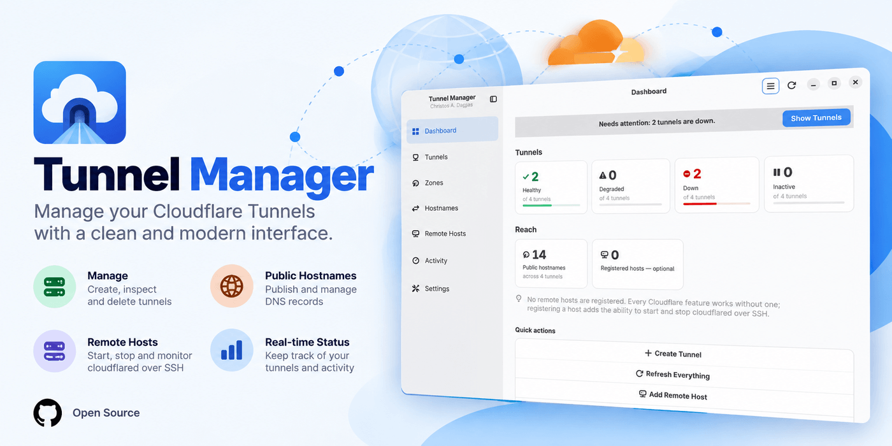

# Tunnel Manager



**Made for Fedora with the GNOME desktop (tested on Fedora 44).**

Tunnel Manager is a simple desktop application for your Cloudflare Tunnels.
It talks to Cloudflare's public API and lets you:

- Create, rename and delete tunnels, and see which are running.
- Publish hostnames on your domains with one reviewed click, and remove them
  cleanly.
- Install and control the `cloudflared` service on your own machines.

Your Cloudflare **API token** is stored in GNOME Keyring — never in a file —
and only the permissions it needs are asked for.

Tunnel Manager is an unofficial, third-party tool. It is not affiliated with
or endorsed by Cloudflare, Inc.

## Install

```sh
sudo dnf install ./tunnel-manager-1.0.0-1.fc44.x86_64.rpm
```

Build the RPM yourself with the instructions in
[dist/rpm/README.md](dist/rpm/README.md), or run the app straight from the
source:

```sh
sudo dnf install gtk4-devel libadwaita-devel rust cargo
git clone https://github.com/christosdaggas/Cloudflare.git
cd Cloudflare && cargo run --release --locked
```

## Getting started

1. Create an API token at **Cloudflare → My Profile → API Tokens**. It needs
   *Cloudflare Tunnel → Edit*, *Zone → Read* and *DNS → Edit* — nothing else.
2. Paste it into the app and tick **Remember this token**. That's it.

To control `cloudflared` on another machine, register it on the Hosts page.
Everything else works without any setup.

## Removing the app

```sh
sudo dnf remove tunnel-manager
```

Your data is not deleted: settings are in `~/.local/share/tunnel-manager/`
and the token is in GNOME Keyring (use **Settings → Remove Saved Token**).

## Links

- Website: <https://chrisdaggas.com>
- Source and issues: <https://github.com/christosdaggas/Cloudflare>
- Contact: <info@chrisdaggas.com>
- Licence: [MIT](LICENSE)
